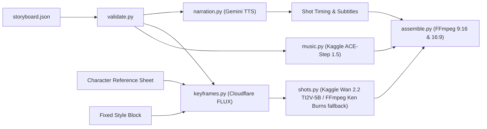

# Architecture & Dependency Map

## "What Changes What" Map

## Change Impact Rules
- Changing **shot `N` `image_prompt`** -> regenerates **keyframe `N`** -> **clip `N`** -> **final edit**.
- Changing **shot `N` `narration`** -> regenerates **narration `N`** -> **timing/subtitles** -> **final edit**.
- Changing **`style_block` or `character.selected_reference_image`** -> regenerates **ALL keyframes** -> **ALL clips** -> **final edit**.
- Changing **`music.caption` / `tempo_bpm` / `seed`** -> regenerates **score** -> **ducking & final edit**.
- Changing **`end_card.text` / `duration_sec`** -> regenerates **only the end card** -> **both final exports**.

## Stage contracts and hash ownership
`pipeline/contracts.py` is the single recipe book for input hashes. The real stages and the dry-run planner call the *same* functions, so `py run.py plan` cannot disagree with what a stage caches.

| Stage | Reads | Writes | Cache key inputs | Downstream |
| :--- | :--- | :--- | :--- | :--- |
| `validate` | storyboard.json, schema | nothing | n/a | every stage refuses to run without it |
| `narration.py` | shot narration, tts_style, `models.tts` | `outputs/narration/shot_NN.wav` | text + model + voice | timing, subtitles, final |
| `keyframes.py` | image_prompt, image_seed, style_block | `outputs/keyframes/shot_NN.png` | prompt + seed + steps + style (+ ref if used) | clips |
| `music.py` | music caption + params, imported WAV | `outputs/music/candidate_*.wav` | caption + music hash + filename | mix, final |
| `shots.py` | keyframe, video prompt, video seed | `outputs/clips/shot_NN.mp4` | video params + keyframe hash + source | final |
| `assemble.py` | clips, narration, score, end card | `outputs/final/film_*.mp4` | all clip/narration/music hashes + aspect + settings | deliverable |
| `second_language.py` | `translations/afaan_oromo.json`, English subtitles, one TTS call | `outputs/narration_om/shot_*.wav`, `outputs/final/film_*_om.mp4` | translation prompt + lines + TTS hash + split method | alternate exports only; locked `storyboard.json` untouched |

A cache hit means: the file exists, its `outputs/manifest.json` hash matches the current recipe, and its status is `ok`. Changing one shot's prompt or narration line changes only that shot's hash, so `plan` reports one clip/one WAV and the two finals — not all ten shots.

## Assembly details
- Subtitles are generated as per-aspect `.ass` files with `PlayResX/Y` equal to the export size, so font size and safe-area margins are real pixels.
- Audio: 10 padded narration slots + end-card silence -> `sidechaincompress=threshold=0.02:ratio=6:attack=300:release=1500` on the score -> `amix=duration=longest` -> two-pass `loudnorm=I=-14:TP=-1:LRA=11`.
- Both exports use `-r 24 -fps_mode cfr`, `libx264`/`yuv420p` and AAC 192k.
