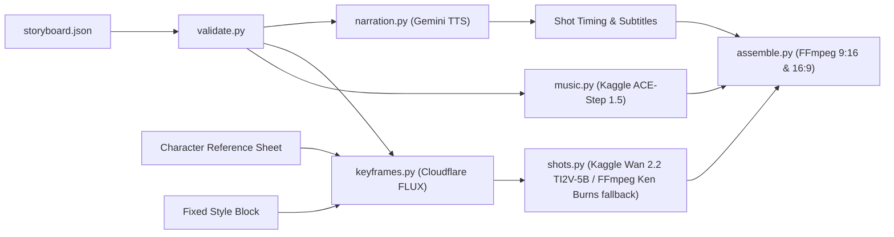

# Architecture & Dependency Map

## "What Changes What" Map

## Change Impact Rules
- Changing **shot `N` `image_prompt`** -> regenerates **keyframe `N`** -> **clip `N`** -> **final edit**.
- Changing **shot `N` `narration`** -> regenerates **narration `N`** -> **timing/subtitles** -> **final edit**.
- Changing **`style_block` or `character.selected_reference_image`** -> regenerates **ALL keyframes** -> **ALL clips** -> **final edit**.
- Changing **`music.caption` / `tempo_bpm` / `seed`** -> regenerates **score** -> **ducking & final edit**.
